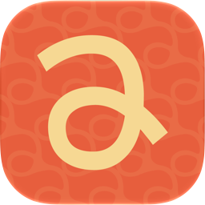
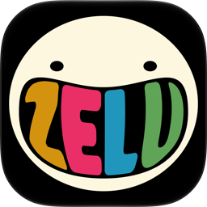
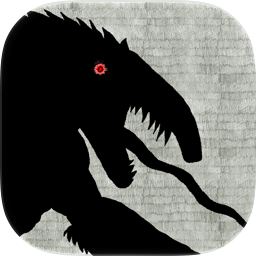
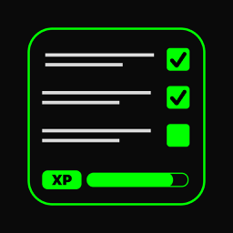

# Hi, I'm Jonas 👋

### iOS Developer · SwiftUI · Apple Developer Academy | Mackenzie Ambassador

I build native apps for Apple platforms with SwiftUI, from the first sketch to the App Store.
**6 apps published** and Computer Science student at
Universidade Presbiteriana Mackenzie.

 

---

## 📱 Apps on the App Store

<table width="100%">
  <tr>
    <td align="center" width="33%">
      
      <h4>Pipa: Para Partilhar</h4>
      Fair, automatic chore division for people who share a home.
        
      
      
    </td>
    <td align="center" width="33%">
      
      <h4>Zelu</h4>
      Keep your friendships alive before they drift into the void.
        
      
      
    </td>
    <td align="center" width="33%">
      
      <h4>Causos Ocultos: Quixeramobim</h4>
      Folklore suspense game for iPhone and Apple Watch.
        
      
      
    </td>
  </tr>
  <tr>
    <td align="center" width="33%">
      
      <h4>Vivacidade</h4>
      Capture a moment of the city and make it last.
        
      
      
    </td>
    <td align="center" width="33%">
      
      <h4>CyberDo</h4>
      Gamified to-do list: quests, XP, levels and streaks.
        
      
      
    </td>
    <td align="center" width="33%">
      
      <h4>UniEsportes</h4>
      University athletic associations and championships in one app.
        
      
      
    </td>
  </tr>
</table>

### 🧩 My part & highlights

| App | My part | Highlights |
|-----|---------|------------|
| **Pipa** | Team member with the most commits; gamification (ranks and coupons), retrospective flow, animations and onboarding | SwiftUI, CloudKit, Foundation Models (Apple Intelligence), ESP32 hardware companion, unit tests |
| **Zelu** | Group creation and editing, search inside groups, swipe-up tab bar | SwiftUI, SpriteKit physics scene, MultipeerConnectivity, CoreBluetooth, SwiftData + CloudKit, StoreKit 2, MVVM |
| **Causos Ocultos** | All entity logic and interactions between entities, SwiftUI + SpriteKit integration, screen navigation | SpriteKit game inside SwiftUI, Apple Watch companion app, iOS + watchOS integration |
| **Vivacidade** | Implemented the `ARView` and adding elements to the scene; built the logic that places an element in the real world and saves its coordinates so it can be loaded again in the same spot | SwiftUI, ARKit (augmented reality), world anchoring with persisted positions, audio recording and playback, custom file sharing || **CyberDo** | Solo: design, development and App Store release | Core Data with relationships, game rules (XP, levels, attributes, streak multiplier), remote JSON with `async/await`, local notifications |

---

## 🧪 Other projects

- [**POC_CloudKit**](https://github.com/JonasFNMelo/POC_CloudKit): a minimal social app built only on CloudKit — public and private databases, record references, queries, MVVM + service layer
- [**CoreDataMedium**](https://github.com/JonasFNMelo/CoreDataMedium): companion code for a Medium article teaching Core Data, from setup to many-to-many relationships
- [**CoMusic**](https://github.com/JonasFNMelo/CoMusic): Instagram redesigned as a music app, a hands-on study of Apple's Human Interface Guidelines
- [**SpeedDatingWWDCApp**](https://github.com/JonasFNMelo/SpeedDatingWWDCApp): icebreaker app pairing Academy students and alumni at WWDC events
- [**SpaceInTetris**](https://github.com/SpaceInTetris/SpaceInTetris): my first Swift project, a terminal Tetris for macOS built in a team of three

---

## 🛠️ Tech Stack

**Platforms:** iOS · watchOS · macOS · tvOS

**Apple frameworks:** Swift · SwiftUI · SwiftData · Core Data · CloudKit · SpriteKit · ARKit · AVFoundation · Foundation Models (Apple Intelligence) · App Intents · UserNotifications · PhotosUI · MapKit

**Architecture & practices:** MVVM · service layers · `async/await` · `Codable` + `URLSession` · Conventional Commits · pull-request workflow

**Tools:** Xcode · Git · GitHub · GitHub CLI · TestFlight · App Store Connect · Figma · XcodeCloud 

**Also:** C · Java · Python

  
  
  
  
  
  
  
  
  
  

---

## 🎓 Education

- **Computer Science** — Universidade Presbiteriana Mackenzie (expected 2028)
- **Apple Developer Academy | Mackenzie**
